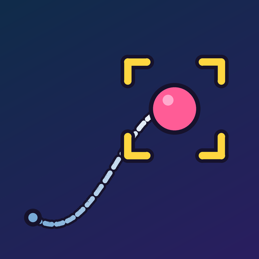

# Beutl.Extensions.MotionTracking



動画の中の点を追跡し、その動きをキーフレームとしてオブジェクトに適用するBeutl拡張機能です。文字や画像を動く物に貼り付けたり、手ブレを補正したりできます。

結果はBeutlの普通のキーフレームとして書き込むので、再生にこの拡張機能は必要なく、適用した後は他のアニメーションと同じように編集できます。

Beutl 2.0.0-preview.10 以降で動作します。

## 使い方

1. タブの追加メニューから「モーショントラッキング」を開きます。プレビューの隣にタブが開きます。
2. タイムラインで追跡する動画の要素を選び、「選択中の要素を使う」を押します。タブにはその要素だけが表示され、最初のトラッカーが画面の中央に置かれます。
3. 再生ヘッドを追跡を始めるフレームに移し、トラッカーを追跡したいものの上までドラッグします。
4. ツールバーの「前へ追跡」（▶▶）を押します。途中で止めるには「追跡を止める」（■）を押します。
5. 動きを付けたい要素をタイムラインで選び、「適用」の「選択中の要素を使う」を押します。
6. 再生ヘッドを、今の配置のままにしたいフレームに移して「適用」を押します。

適用した後でも、プレビューで要素をドラッグすれば追跡した動きとの位置関係を調整できます。

## トラッカー

トラッカーには2つの枠があります。

| 枠 | 意味 |
| --- | --- |
| 実線の枠（パターン） | 追跡する見た目です。コントラストのはっきりした、角や模様のある場所に置きます。 |
| 破線の枠（検索範囲） | 次のフレームでパターンを探す範囲です。動きが速いときは広げます。 |

| 操作 | 方法 |
| --- | --- |
| 移動 | 枠の内側をドラッグします。ドラッグ中は枠の中を拡大した画面が表示されます。 |
| 大きさの変更 | 選択中のトラッカーの枠の角をドラッグします。 |
| 追加 | フレームの何もないところをダブルクリックするか、一覧の「＋」を押します。 |
| 削除 | 選択して Delete キーを押すか、一覧のごみ箱を押します。 |
| 使わない | 一覧のチェックを外すと、追跡にも適用にも使いません。 |
| 拡大表示 | ホイールで拡大します。右ボタンか中ボタンのドラッグで表示を動かします。ツールバーの「全体を表示」で戻します。 |

「この場所の特徴」には、トラッカーの場所が追跡に向いているかを表示します。「弱い」と表示されるときは、模様の少ない場所や直線の上なので、別の場所に置いてください。

## 追跡

ツールバーのボタンで、再生ヘッドから前後へ追跡します。

| ボタン | 動作 |
| --- | --- |
| 1 フレーム戻って追跡 / 1 フレーム進んで追跡 | 1フレームだけ追跡します。 |
| 後ろへ追跡 / 前へ追跡 | 要素の先頭または末尾まで追跡します。 |
| 追跡を止める | 止めます。そこまでの結果は残ります。 |

- フレームの下のバーに、トラッカーごとの追跡済みのフレームを表示します。赤い部分はパターンとの一致度が低いフレームです。バーを押すとそのフレームへ移動します。
- フレームの上の線はトラッカーの軌跡です。一致度が低い部分は赤くなります。
- パターンを見失うか画面の外に出ると、そのトラッカーは止まります。止まった理由は下の行に表示します。
- 追跡の途中でずれたときは、そのフレームでトラッカーをドラッグして直し、もう一度追跡します。その先の結果が上書きされます。
- 物が隠れて見失ったときは、また見えたフレームでトラッカーを置き直し、そこから追跡を続けます。

追跡に使う映像は、その要素だけを、タイムラインの見た目どおりの位置に描画したものです。上に重ねたオブジェクトの影響は受けません。追跡中に編集しても、実行中の追跡には影響しません。

### 詳細設定

| 設定 | 内容 |
| --- | --- |
| パターン幅・高さ、検索の幅・高さ | 枠の大きさです。枠の角のドラッグと同じものです。 |
| 追跡内容 | 既定の「位置・回転・拡大」は、パターンの向きと大きさも追います。パターンから判断できない場合（丸い点の向き、角の大きさなど）は、その分だけ追いません。「位置のみ」は、回転や拡大縮小するパターンでは位置が少しずつずれます。 |
| 見本の更新 | 「自動で更新」は見た目の変化についていきながら、追跡を始めたときの見た目と比べてずれを直します。「最初のまま」はずれませんが、見た目が変わると止まります。 |
| 止める信頼度 | パターンとの一致度がこれを下回ると止まります。見失っても動き続けるときは上げ、すぐ止まるときは下げます。 |
| 結果を消す | 選択中のトラッカーの結果を、すべて、または再生ヘッドより前か後だけ消します。 |

## 適用

| 動作 | 内容 |
| --- | --- |
| オブジェクトを動きに合わせる | 適用先の要素が、追跡した動きについて行きます。再生ヘッドのフレームでは今の配置のままです。 |
| 手ブレを補正（固定する） | 追跡元の要素を逆向きに動かし、追跡した点を再生ヘッドのフレームの位置に固定します。 |
| 手ブレを補正（滑らかにする） | 追跡元の要素の細かい揺れだけを取り除きます。カメラを振る動きは残ります。 |

手ブレを補正すると映像の端に隙間ができます。隙間が見えないように、要素を少し拡大してください。

- 「位置」「回転」「拡大縮小」で、適用する動きを選びます。既定は位置だけです。
- トラッカーが1つのときは、そのトラッカーの位置・回転・拡大率を使います。
- トラッカーが2つ以上のときは、すべてのトラッカーに最もよく合う動きを計算します。チェックしたトラッカーすべてに結果があるフレームだけを使います。回転や拡大縮小を正確にするには、離れた2点を追跡します。
- 「滑らかさ」は動きを滑らかにする幅で、前後のフレーム数です。0 で滑らかにしません。「滑らかにする」手ブレ補正では、大きいほど大きな揺れまで取り除きます。
- 「キーフレーム」で密度を選びます。「標準」と「少なめ」は、元の動きとの差が指定の範囲に収まるように間引きます。

キーフレームは、適用先の要素のトランスフォームの先頭に「モーショントラッキング」という名前のグループとして追加します。もとのトランスフォームはそのまま残ります。もう一度適用するとグループを作り直し、「解除」で取り除きます。どちらもBeutlの「元に戻す」で戻せます。

キーフレームの時刻は適用先の要素の先頭から数えます。追跡元と適用先の要素を別々に動かすと動きがずれるので、一緒に動かすか、もう一度適用してください。

## 保存

トラッカーと追跡結果はタブの状態として保存され、プロジェクトを開き直しても残ります。タブを閉じると消えますが、適用済みのキーフレームはそのまま残ります。

追跡元を別の要素に変えると、トラッカーは残りますが追跡結果は消えます。

## 開発

```bash
dotnet build
```

```bash
dotnet test
```

テストの一部はBeutlの描画パイプラインを実際に使います。GPUが使えない環境では、それらのテストはスキップされます。環境変数 `MOTION_TRACKING_UI_RENDER_DIR` にフォルダを指定すると、テストで描画したタブの画面をPNGで保存します。

### 構成

| フォルダ | 内容 |
| --- | --- |
| `src/.../Tracking` | 追跡アルゴリズムと動きの計算です。Beutlに依存しません。 |
| `src/.../Rendering` | シーンの複製から追跡元の要素だけを描画します。 |
| `src/.../Editing` | ツールタブとキーフレームの書き込みです。 |

パターンの追跡は、画像ピラミッド上の正規化相互相関で粗く探し、Inverse Compositional Lucas-Kanade法で小数ピクセルまで合わせます。どちらも明るさとコントラストの変化を打ち消します。

## ライセンス

[MIT](LICENSE)
